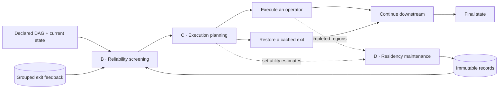

<div align="center">

# GeoLeap

**Reliability-guided subgraph reuse for declared workflows**

[](pyproject.toml)
[](requirements.txt)

[Quick start](#quick-start) · [Architecture](#architecture) · [Core API](#core-api) · [Configuration](#configuration) · [Workflow catalog](#workflow-template-catalog) · [Scope](#scope-and-contracts)

</div>

GeoLeap is a research implementation of workflow-level caching. It represents a workflow as a declared directed acyclic graph (DAG), captures reusable regions as immutable records, and restores their exit state so execution can continue downstream.

The core separates three decisions: **whether a record qualifies for reuse, which execution actions to choose, and which records to retain**. Screening rules, execution planning, and residency policies are independently configurable.

This repository provides the core runtime, local examples, offline functional checks, and a generated workflow template catalog. The core uses the Python standard library; no model credentials, external services, or benchmark data are needed to get started.

## Quick start

**Requirement:** Python 3.10 or later.

```bash
git clone https://github.com/DulingXu/GeoLeap.git
cd GeoLeap

# Run the offline functional suite.
python3 checks/run_core_checks.py

# Execute a minimal local workflow.
PYTHONPATH=src python3 examples/core_demo.py
```

The checks use local functions and synthetic fixtures. They exercise the actual runtime, including cached replacement and downstream execution, without invoking model APIs or remote tools.

Reports are generated under `output/core_checks/`, with a summary and a separate directory for each module. Generated output is excluded from version control. See the [check catalogue](checks/README.md) for module names and output formats.

## Architecture



The diagram shows alternative execution actions within a request. Cache maintenance is invoked explicitly between requests, separately from the serving lookup path.

| Component | Responsibility | Implementation |
| --- | --- | --- |
| **Workflow contract** | Declare dependencies, field schemas, semantic versions, and single-entry/single-exit cache regions. | [`spec.py`](src/workflow/spec.py) |
| **B — Reliability screening** | Apply hard compatibility guards, input similarity, and configurable checks on grouped exit feedback. Evidence is isolated by subgraph, immutable record revision, epoch, and similarity bin. | [`reliability.py`](src/workflow/reliability.py) |
| **C — Execution planning** | Choose execution and reuse actions using a latency–cost objective, bounded lookahead, and historical compatibility forecasts. Recheck a selected record before committing reuse. | [`planner.py`](src/workflow/planner.py), [`scheduling.py`](src/workflow/scheduling.py) |
| **D — Residency management** | Manage admission, audit retention, promotion, and eviction using recency, independent value, or marginal set utility. | [`residency.py`](src/workflow/residency.py) |
| **Record lifecycle** | Maintain immutable payloads, versioned snapshots, pinned readers, and atomic publication. | [`records.py`](src/workflow/records.py) |
| **Memory accounting** | Share an object budget across records, evidence, forecasts, workspaces, and bounded query-vector caches. | [`memory.py`](src/workflow/memory.py) |
| **Runtime and observation** | Execute operators, capture complete regions, restore declared exits, and expose traces and reference-feedback interfaces. | [`runtime.py`](src/workflow/runtime.py), [`observability.py`](src/workflow/observability.py) |

## Core API

An operator reads declared fields and returns a patch containing its declared outputs. A cache region groups eligible operators; a reuse action restores only its declared exit fields.

The following deterministic local example demonstrates the record lifecycle under the `full` qualification rule. Only `prepare` is cached; `finish` continues to execute after reuse.

```python
from workflow.b1 import B1Config
from workflow.spec import OperatorSpec, WorkflowSpec

workflow = WorkflowSpec("example", (
    OperatorSpec(
        "prepare",
        lambda state: {"mid": state["x"] * 2},
        read_fields=("x",), write_fields=("mid",),
        cacheable=True, effect_free=True,
        latency_ms=10.0, cost_usd=0.001,  # Illustrative planning profiles.
    ),
    OperatorSpec(
        "finish",
        lambda state: {"answer": state["mid"] + 1},
        dependencies=("prepare",),
        read_fields=("mid",), write_fields=("answer",),
    ),
))

region = workflow.subgraph("prepared", ("prepare",))
runtime = B1Config().make_runtime(workflow, (region,))

# Execute normally and admit the completed region to the audit partition.
runtime.run({"x": 2}, request_id="cold")
runtime.maintenance_tick()

# Supply reference observations, then run explicit maintenance.
for i in range(3):
    runtime.audit({"x": 2}, request_id=f"reference-{i}")
runtime.maintenance_tick()

result = runtime.run({"x": 2}, request_id="warm")
assert result.state["answer"] == 5
assert result.reused_subgraphs == ("prepared",)
assert result.executed_node_ids == ("finish",)
```

Run this code with `PYTHONPATH=src`. The repeated input and reference IDs are synthetic fixtures for demonstrating API behavior. The example does not evaluate reuse across different tasks, and its latency/cost profiles are not measurements. Integrations must define their own reference protocol, observation groups, and exit comparator.

### Record lifecycle

1. **Capture:** a completely executed region can produce an immutable candidate. A region containing an internal cache substitution is not treated as a fresh reference execution.
2. **Collect evidence:** reference comparisons can contribute grouped exit feedback. Normal-execution feedback and actual-hit audits are explicit options; a lookup does not silently run a reference workflow.
3. **Maintain:** call `runtime.maintenance_tick()` between requests to process queued records, update residency, and promote records that meet the configured qualification rules. Audit-only records cannot serve requests.
4. **Reuse:** the planner selects an eligible record, the runtime revalidates it, restores the exit patch, and continues with the remaining operators. Failed validation falls back to normal execution.

[`check_core_integration.py`](checks/check_core_integration.py) provides further executable examples of state restoration, reference feedback, promotion, and fallback.

### Input representations

The default encoder is a local, 128-dimensional hashed character-trigram representation. A subgraph can declare which boundary fields contribute to similarity; hard compatibility fields remain checked independently.

Applications can register an external encoder through `register_input_encoder(identity, callable)` and select it using `GeoLeapRuntime(..., input_encoder_id=identity)`. Encoder identities cannot be rebound. Records retain their encoder identity, and cross-encoder reuse is rejected. External encoders must produce deterministic, finite, nonzero vectors under a versioned identity; their resources are managed by the integrating application.

See [`check_similarity_projection.py`](checks/check_similarity_projection.py) and [`check_input_encoder.py`](checks/check_input_encoder.py) for interface examples and compatibility checks.

## Configuration

| Concern | Interface | Available controls |
| --- | --- | --- |
| Qualification | [`B1Config`](src/workflow/b1.py) | `similarity`, `no_margin`, `min1`, `full`; similarity, support, and disagreement thresholds |
| Planning policy | [`C1Config`](src/workflow/c1.py) | `no_cache`, `greedy`, `full` |
| Search budget | [`C2Config`](src/workflow/c2.py) | Bounded or exhaustive search; depth, beam width, and exhaustive-search limits |
| Residency policy | [`D1Config`](src/workflow/d1.py) | `lru`, `legacy_density`, `additive_value`, `full` |
| Change scenarios | [`D2Config`](src/workflow/d2.py) | `demand_shift`, `cost_shift`; request-boundary updates and window statistics |

For qualification, `similarity` retains the hard guards without requiring historical exit evidence. `no_margin` requires valid evidence, the configured minimum number of observation groups, and `mean <= max_score`. Both `min1` and `full` require `min(1, mean + margin) <= max_score`: `min1` requires at least one valid observation group, while `full` requires the configured minimum number of groups. Missing evidence is not a zero disagreement score.

The configuration entry points can be inspected without executing a workflow:

```bash
PYTHONPATH=src python3 -m workflow.b1 --b1-variant full
PYTHONPATH=src python3 -m workflow.c1 --c1-variant greedy
PYTHONPATH=src python3 -m workflow.c2 --c2-variant bounded --c2-depth 3 --c2-beam-width 8
PYTHONPATH=src python3 -m workflow.d1 --d1-variant full --d1-capacity-mib 4
PYTHONPATH=src python3 -m workflow.d2 --d2-stream demand_shift --d2-variant full
```

These commands display configuration; they do not run benchmarks. Python callers can use the configuration classes' `make_runtime` or `make_planner` factories. `C1Config` and `C2Config` prepare fixed-cache comparisons. For online accumulation, use `GeoLeapRuntime` or `B1Config` with `fixed_cache=False` and an explicit feedback/maintenance schedule.

## Workflow template catalog

The [catalog](datasets/workflow_catalog_v1/) contains **200 declared DAG templates**: 100 for multi-hop retrieval-augmented QA and 100 for text-to-SQL. Typed graph rewrites combine stage insertion, complementary strategy branches and joins, and bounded retrieval or execution-guided refinement. Stage organization draws on [DSPy BasicMultiHop](https://arxiv.org/html/2310.03714#S7) and [DIN-SQL](https://arxiv.org/abs/2304.11015); the templates are generated derivatives rather than original benchmark traces or reproductions of those methods.

| Scenario | 3–10 nodes | 11–19 nodes | 20–29 nodes | 30–50 nodes | Total |
| --- | ---: | ---: | ---: | ---: | ---: |
| Retrieval-augmented QA | 70 | 20 | 7 | 3 | **100** |
| Text-to-SQL | 70 | 20 | 7 | 3 | **100** |

Both scenarios have a median of nine nodes. Within each scenario, exact directed graph-isomorphism checks exclude duplicate topology even when node names, operator labels or parameters differ. The catalog includes operator contracts, cache-region declarations, fixed generation settings, checksums, and [representative DAG diagrams](datasets/workflow_catalog_v1/EXAMPLES.md).

```bash
# Validate all 200 templates through the core using synthetic dataflow fixtures.
python3 checks/check_workflow_catalog.py --output output/workflow_catalog/validation.json

# Reproduce the catalog in a new directory; existing output is never overwritten.
python3 scripts/generate_workflow_catalog.py --output output/workflow_catalog/reproduced
```

Validation checks structure, typed interfaces and complete state propagation without model, retrieval or database calls. Real services require explicit operator bindings. The larger DAGs support structure and scale stress tests; catalog validation does not establish benchmark quality, cost savings or parallel speedup. See the [catalog documentation](datasets/workflow_catalog_v1/README.md) for provenance and execution contracts.

## Validation

The offline suite covers structure and boundary validation, qualification rules, planning choices, residency policies, record versions, memory-pressure rollback, encoder isolation, and actual state restoration.

```bash
# Check one component.
python3 checks/run_core_checks.py --module b1_screening_switches

# Select a report directory.
python3 checks/run_core_checks.py --output-dir /tmp/geoleap-checks
```

Functional checks establish code-path behavior under their fixtures. They do not establish benchmark quality, measured speedups, cost savings, or statistical guarantees.

## Scope and contracts

- **Declared execution structure.** The workflow DAG and field contracts are known before serving. Callers are responsible for accurately declaring dependencies, versions, critical fields, and side effects. Stateful or effectful operations require application-specific handling.
- **Serial serving runtime.** The executor processes one request serially. Multi-worker settings belong to planner diagnostics; they do not enable parallel operator execution in the serving runtime.
- **Empirical qualification.** Grouped feedback and empirical margins support configurable reuse decisions. They are not calibrated probabilities or a formal guarantee of task correctness. Exhaustive search is a same-information planning reference, not an oracle with future outputs.
- **Explicit resource semantics.** Serialized-storage limits and the optional Python-object ledger are distinct. The ledger does not establish a complete cache-only physical-memory or process-RSS bound. Native allocations, allocator behavior, and unregistered temporaries have separate accounting requirements. See the [memory interface](doc/cache_memory.md).
- **Application-supplied service profiles.** Operator latency and cost fields are planning/accounting inputs. They are not measured service latencies or API invoices. External integrations own service invocation, measurement, and billing reconciliation.

The release includes generated workflow declarations; benchmark adapters, benchmark records, deployment profiles, model weights, experiment logs, and benchmark results remain outside its scope. `LegacyDensity` implements an independent-value density policy within the shared record-management framework.

## Repository layout

```text
src/workflow/                Workflow contracts, B/C/D components, and runtime
checks/                     Offline functional checks and local fixtures
examples/core_demo.py        Minimal workflow execution
datasets/workflow_catalog_v1/  100 QA and 100 SQL DAG templates
scripts/workflow_catalog_*.py  Topology checks and core compiler
scripts/generate_workflow_catalog.py  Reproducible template generator
doc/cache_memory.md         Memory accounting and ownership contracts
PUBLICATION_MANIFEST.json   File inventory and SHA-256 checksums
```
