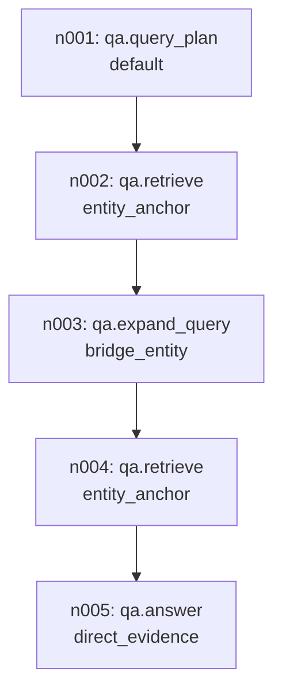
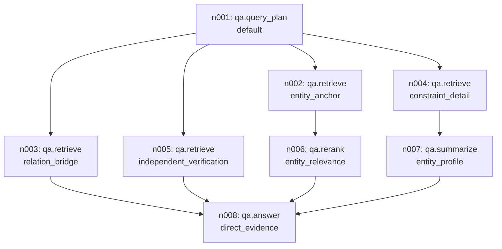
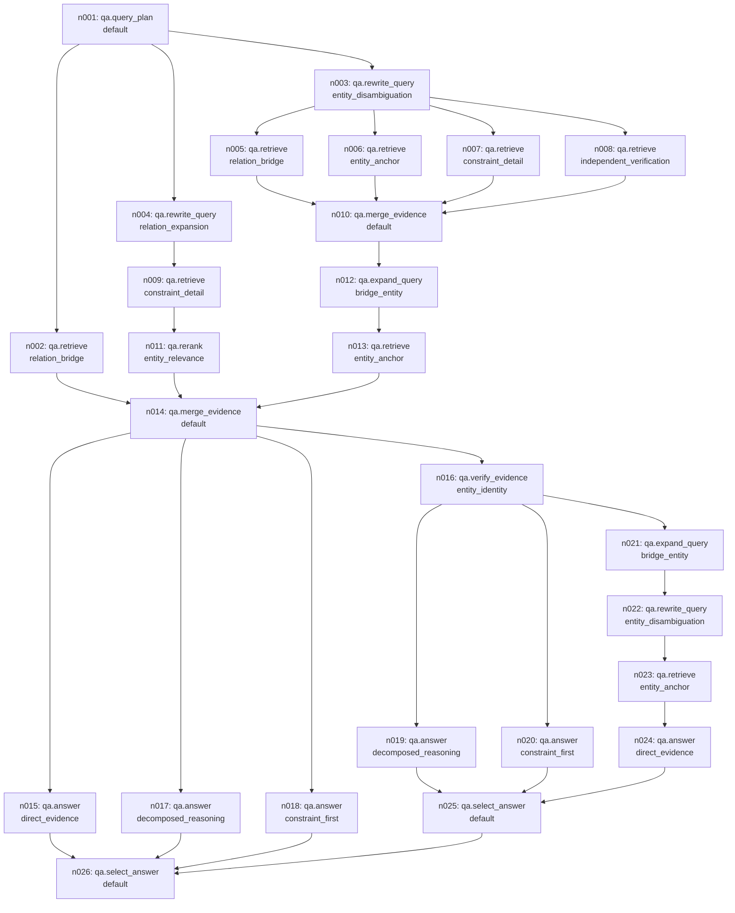
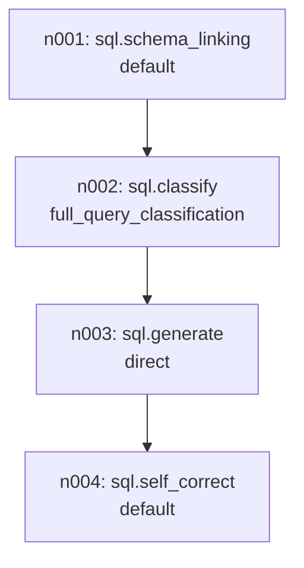
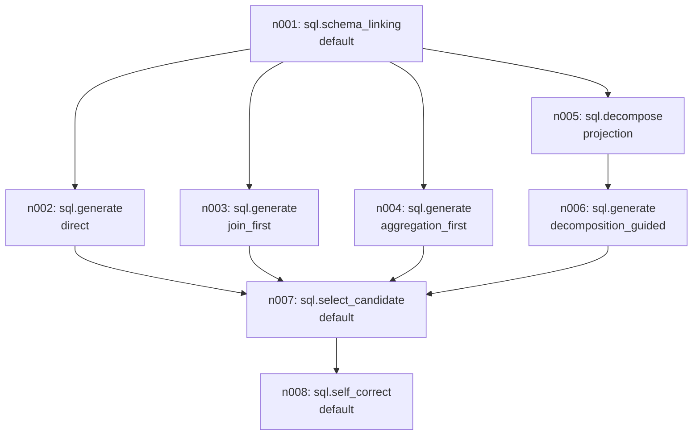
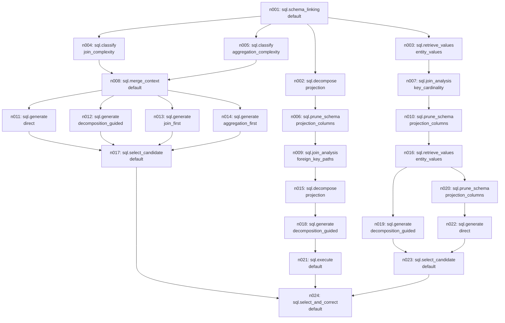

# Representative generated DAGs

Actual declarations from this catalog; diagrams indicate data dependencies, not concurrent execution.

## qa_004: 5 nodes / 4 edges

## qa_025: 8 nodes / 10 edges

## qa_091: 26 nodes / 35 edges

## sql_002: 4 nodes / 3 edges

## sql_025: 8 nodes / 10 edges

## sql_091: 24 nodes / 30 edges

